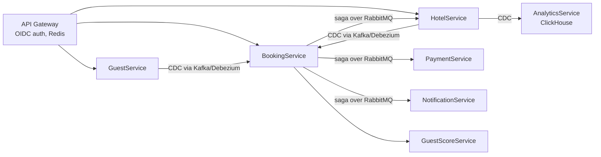

# BookingDemo — a fault-tolerant microservices platform

A hotel-booking platform built as a distributed system in **.NET**, developed over a semester of *Distributed Systems: Fault Tolerance and Distributed Data*. It grew from a few services into a production-shaped system of ~10 services on Kubernetes, demonstrating the core techniques for keeping distributed data correct and services available when things fail.

> **Team project** (Team 06): Ivan Yakovenko, Kyrylo Shykhalov, Ostap Turash. It was built and deployed to a shared GKE cluster with CI/CD; this repository is the source, configuration and design documentation.

## The system

A guest books a hotel room; the booking is reserved, paid for and confirmed across several independent services, each owning its own database.



Services: **ApiGateway**, **AdminGateway**, **HotelService**, **BookingService**, **GuestService**, **PaymentService**, **NotificationService**, **GuestScoreService**, **AnalyticsService**, plus a shared library. Each has its own PostgreSQL database.

## Distributed-systems techniques

### Saga (orchestration) for the booking transaction

Creating a booking spans three services with **no two-phase commit and no distributed locks**. BookingService is the orchestrator: it drives a five-step saga over RabbitMQ — `place-booking → reserve-room → charge-payment → confirm-booking → send-confirmation` — tracking saga state in its own table.

- **Outbox pattern** — each step writes its database change and its outgoing message in one local transaction, so a message is never lost or sent without its state change.
- **Pivot transaction** — `confirm-booking` is the pivot: steps before it (`reserve-room`, `charge-payment`) have **compensating actions** (`release-room`, `refund-payment`); the step after it is retried until it succeeds.
- **Compensation as real business actions** — a refund creates a new refund record rather than deleting the charge, because reversing a payment is a forward business operation, not a database rollback.
- **Correlation IDs** thread through every command and event, so all five steps across three services can be traced as one saga.

The full design, with happy-path and compensation sequence diagrams, is in [`saga/design/saga-design.md`](saga/design/saga-design.md).

### CQRS, read models and Change Data Capture

Originally BookingService made synchronous HTTP calls to HotelService and GuestService to validate a booking — so if either was down, bookings failed. That coupling was removed:

- BookingService keeps **local replica tables** (`RoomReplicas`, `GuestReplicas`) in its own database.
- A **CDC pipeline** (Debezium reading the Postgres WAL → Kafka) streams row changes from the source services into those replicas; the source services don't even know they're being replicated.
- Each projector does an **idempotent upsert guarded by `replica_lsn`** — a row updates only if the incoming log sequence number is newer, so duplicate or out-of-order events never overwrite fresher data.
- The cutover was done safely in two steps: **dual-read** (read the replica but still query the source and log any divergence), then **switch** (remove the HTTP path entirely).

The result: BookingService serves reads even when Hotel and Guest are down — accepting eventual consistency in exchange for availability.

### Fault tolerance and resilience

- **Service mesh (Linkerd)** — per-service authorization policies, mTLS between services, and retry policies (`mesh/`).
- **Resilience policies (Polly)** — retries, timeouts and circuit breakers on cross-service calls.
- **Chaos engineering** (`chaos/`) — experiments that kill pods, inject network delay, and force HTTP 500s to prove the system degrades gracefully.
- **Contract testing (Pact)** (`pacts/`) — consumer-driven contracts so services can evolve without breaking each other.

### Operations

- **Observability** (`observability/`, `monitoring/`) — Grafana dashboards and metrics per service and for the saga.
- **Autoscaling and canary releases** (`scaling/`) — HPA, k6 load tests, and canary routing for safe rollouts.
- **Helm + GKE + CI/CD** (`helm/`, `.github/workflows/`) — each service deploys via Helm; pushes to `develop` build images, push to Google Artifact Registry and roll out to the cluster.

## Run locally

Requires Docker and the .NET SDK.

```bash
docker compose up --build
```

Swagger UIs: HotelService `:5001/swagger`, BookingService `:5002/swagger`, GuestService `:5003/swagger`. (The passwords in `docker-compose.yml` are local-development defaults; real deployments use Kubernetes secrets.)

## Layout

```
src/              the services, each with its own Application layer and database
  Shared/Cdc/     the shared CDC consumer and projector framework
saga/design/      saga design doc and sequence diagrams
mesh/             Linkerd authorization and retry policies
chaos/            chaos-engineering experiments
pacts/            consumer-driven contracts
observability/    Grafana dashboards
scaling/          load tests, autoscaling and canary config
helm/             Helm chart shared across services
.github/workflows/  per-service CI/CD pipelines
```

## Credits

A three-person team project for *Distributed Systems: Fault Tolerance and Distributed Data*. See the saga and CDC design docs for the detailed reasoning behind the architecture.

## License

[MIT](LICENSE)
