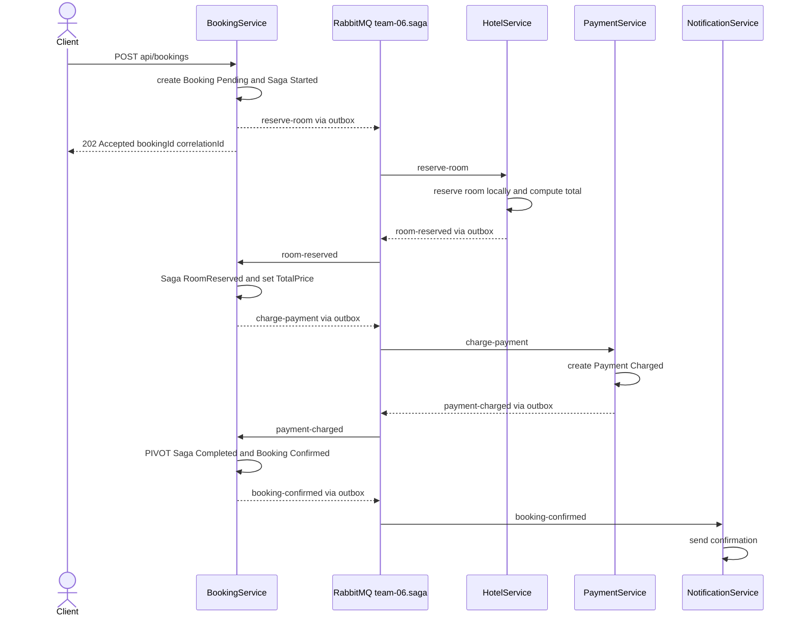
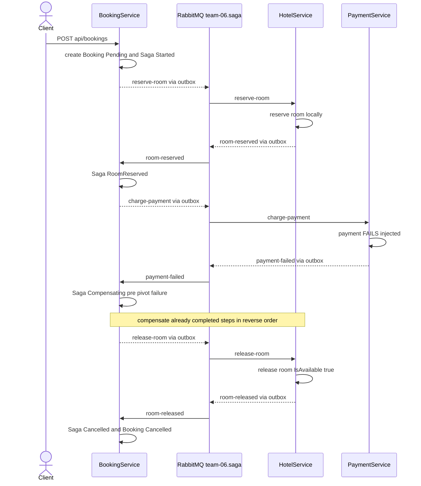

# Saga design
Вирішили взяти сагу з booking і вона описує бізнес операцію із створення бронювання готельного номера котра відбувається за пʼять кроків у трьох сервісах (один створюється додатково) координується повністю через RabbitMQ без розподіленого блокування і без двофазного коміту, 
Перший єтап це Place Booking і він лежить в сервісі BookingService котрий тут виступає оркестратором saga та данний єтап запускається на моменті коли клієнт надсилає запит POST на адресу api bookings після чого BookingService у межах однієї локальної транзакції створює запис бронювання у статусі Pending і створює запис стану саги у стані Started кладе у свій outbox команду reserve room
Другий єтап це Reserve Room належить сервісу HotelService який отримує команду reserve room вирішує локально за домтупної цому інфи чи вільний номер чи ні якщо номер вільний то позначає його , як зайнятий аби потім ми десь не зловили помилку прорахує вартість як ціну за ніч * кількість ночей і аутпутом робить в outbox подію room reserved
Третім єтапом виступає Charge Payment він відноситься до нового сервісу PaymentService котрий напсианий його логіка така що він приймає команду charge payment створює у власній базі запис на списання коштів на ретерн кладе свою outbox подію payment charged
Четвертий єтап в нашій схемі це Confirm Booking лежить в BookingService отримавши подію payment charged бронювання -> Confirmed а стан саги у Completed і він є pivot саги бо саме він фіксує усю операцію
Пʼятий єтап це Send Confirmation і він належить сервісу NotificationService який реагує на подію booking confirmed і надсилає клієнту підтвердження, компенсації працюють так що крок Reserve Room компенсується дією release room яка повертає номеру ознаку доступності і робить його знову вільним, Charge Payment компенсується дією refund payment  окрема бізнес транзакція створює у базі PaymentService новий запис повернення коштів , а саме створює новий запис а не просто видаляє запис списання тому що повернення це не про  відкат бази даних а справжня зворотна бізнес дія яка теж має бути нормальною, Send Confirmation не має компенсації тому що він стоїть після pivot і його не можна відкотити тому при будь якому збої цей крок просто повторюється через механізм retry та чергу DLQ доки комплітнетьс, pivot saga є Confirm Booking і кроки які стоять до pivotа Reserve Room і Charge Payment для них має бути зворотна дія а Send Confirmation мають повторюватися 
Для координації обрано саме оркестрацію, не хореографію тому що центральний координатор у BookingService тримає весь стан саги в одному місці у таблиці стану тому поточний стан легко запитати простим запитом по correlation id ще однією важливою деталью те що при оркестрації набагато простіше виконувати повернення у правильному зворотному порядку при помилці на середині 
Ще одного центрального місця простіше зняти метрикі для дашборду 
А взагалі BookingService у системі починає і веде бронювання тож роль координатора є логічною, всередині саги немає жодних синхронних крос сервісних читань ані координатор ані будь який крок не викликає HTTP або gRPC іншого сервісу щоб дочитати його стан аатомість кожна команда має дані для приймачу
Приймач вирішує локально на своїх даних і відповідає подією наприклад вартість бронювання рахує саме HotelService на основі своєї ціни за номер і повертає готову суму в події room reserved BookingService потім просто бере цю суму для команди charge payment, кожне повідомлення саги має спільний correlation id який генерується один раз на старті саги і передається далі у заголовку x correlation id кожної команди і кожної події так що логи усіх пʼяти кроків у всіх трьох сервісах повязані одним correlation id і за ним можна простежити весь хід однієї саги від старту до завершення, 
В ідеальному завершенні бронювання проходить шлях зі стану Pending у стан Confirmed а сага проходить шлях зі стану Started через RoomReserved та PaymentCharged у стан Completed, у разі збою на середині сага переходить у стан Compensating виконує кешбек дій і завершується у стані Cancelled, а бронювання при цьому переходить у стан Cancelled.

## Happy path

Файл діаграми saga-happy-path.png показує наш потік.

## Compensation path

Файл з діаграмою saga-compensation-path.png демострує нас сценарій збою на кроці оплати у випадку коли вже завершений крок з Reserve Room кешбекується дією release room у зворотьому порядку  якщо перед збоєм встиг пройти ще і крок Charge Payment то кешбек виконався б теж вернувся назад спершу refund payment , а потім release room.

Для створення графіків виокристовувався штучний інтелект